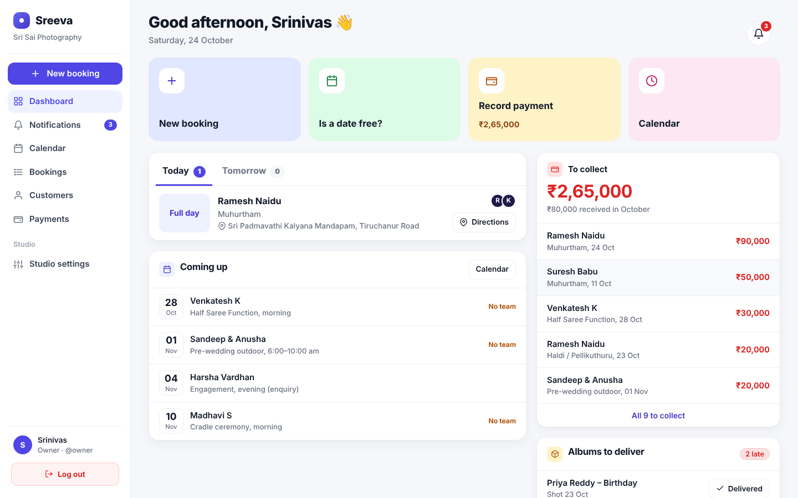
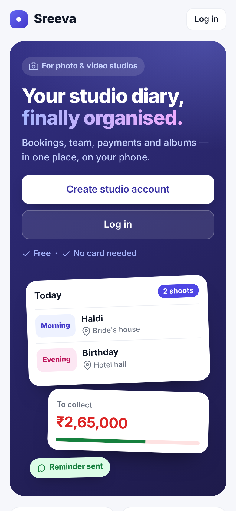
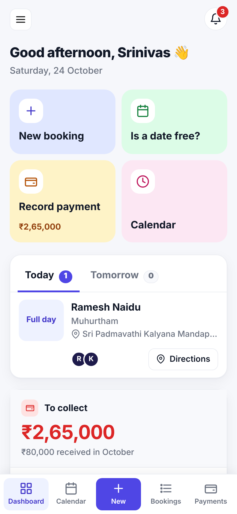
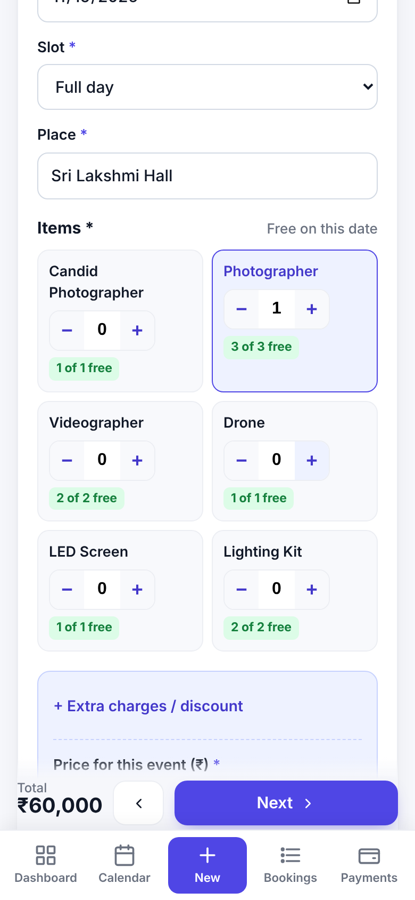
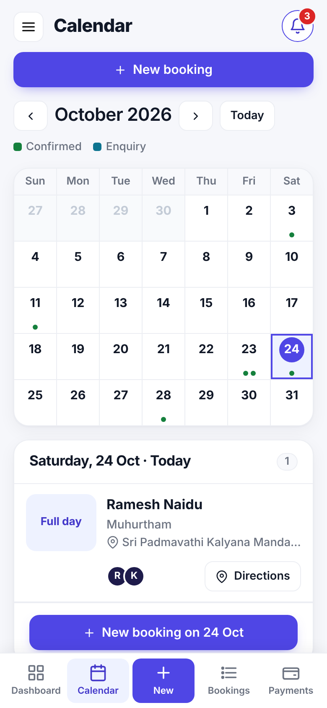
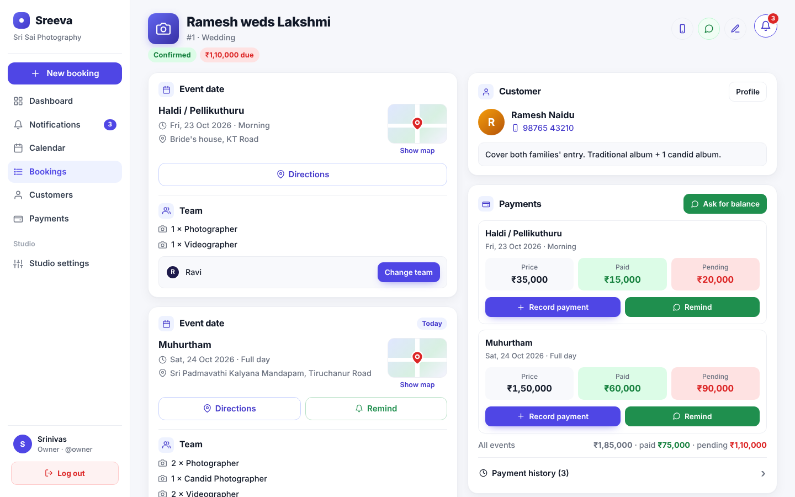
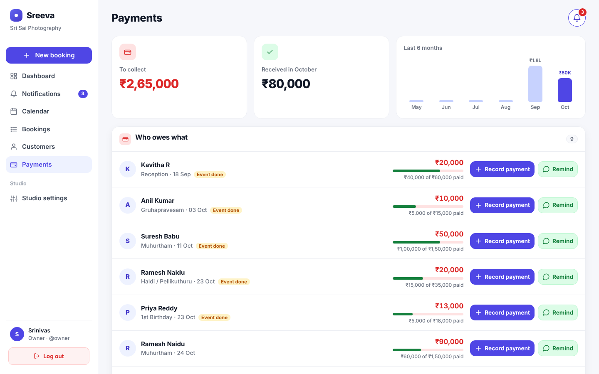
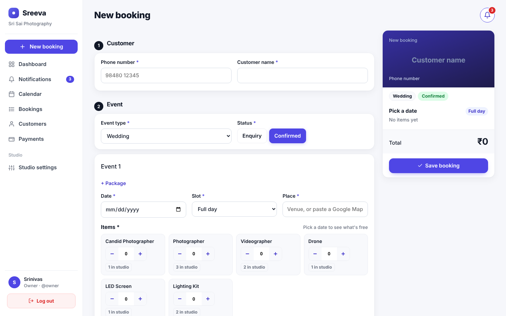

# Sreeva — Photo Studio Management

**Your studio diary, finally organised.** Sreeva replaces the paper diary of a photo & video studio:
bookings, team and equipment availability, payments, album delivery and staff access — on the phone or the computer.

Built for my father's photography studio.

🔗 **Live:** https://sreeva.pythonanywhere.com — tap **“Try the demo”** to explore a sample studio, no sign-up needed
(or log in with `demo` / `Demo@2026`). The demo studio is separate from real studios and refreshes every day.



<p align="center">
  
  
  
  
</p>

## Features

| | |
|---|---|
| **Bookings** | One booking can hold several event dates (Haldi, Muhurtham, Reception), each with its own slot, venue (or Google Maps link), items and price. Enquiry → Confirmed → Cancelled. |
| **No double booking** | While booking, every item shows live availability ("2 of 3 free") for that date and slot. Confirmed bookings can't overbook unless freelancers are explicitly allowed. |
| **Phone-first booking form** | Three short steps on phones (Customer → Event → Price), − / + steppers, returning customers filled in from their phone number, autosaved drafts. |
| **Dashboard** | Today / tomorrow's shoots, upcoming events, money to collect, late albums, open enquiries, one-tap "Is a date free?". |
| **Calendar** | Month view; tap a date to see that day's shoots or book it. |
| **Payments** | Each event is billed separately; part payments, payment modes, edit history, printable receipts, 6-month chart, who-owes-what list. |
| **WhatsApp** | One tap sends the customer the booking details, a payment reminder, a shoot reminder or "album ready" — no paid API. |
| **Team** | Owner and staff logins; assign staff to events with clash warnings. Staff never see money. |
| **Notifications** | In-app bell with reminders for shoots, dues and late albums. |
| **Works like an app** | Installable on phones (PWA) with its own icon and an offline page. |
| **Data safety** | Automatic daily backups and Excel export. |

## Security

- **Role-based access** — staff get HTTP 403 on payments, settings, staff and audit pages; money is hidden from their screens.
- **Multi-tenant isolation** — every query is filtered by the logged-in user's studio; another studio's booking returns 404.
- **Brute-force protection** — 5 wrong passwords lock that username + IP for 15 minutes.
- **Audit log** — logins, failed logins, lockouts, bookings, payments, deletions and staff changes with user, time and IP.
- **Passwords** — Django validators (length, common, numeric, similarity) and PBKDF2-SHA256 hashing; email-based recovery with single-use, expiring links and rate limiting.
- **Web hardening** — CSRF on every form, HttpOnly / SameSite / Secure cookies, HSTS, X-Frame-Options DENY, nosniff, strict referrer policy, 12-hour sessions.
- **Secrets stay out of code** — the secret key and email password live in private server files, never in the repository.
- Server-side validation of phone numbers, amounts, time ranges and payment limits.

## Tech stack

**Backend:** Python 3.12, Django 5.2, SQLite · **Frontend:** Django templates, vanilla JavaScript, CSS (no framework), PWA service worker · **Hosting:** PythonAnywhere with WhiteNoise · **Tests:** 75 Django tests

## Run it locally

```bash
git clone https://github.com/Rupa-2006/sreeva.git
cd sreeva
python -m venv venv
venv\Scripts\activate          # macOS / Linux: source venv/bin/activate
pip install -r requirements.txt
set DJANGO_DEBUG=1             # development mode (macOS / Linux: export DJANGO_DEBUG=1)
python manage.py migrate
python manage.py seed_demo     # optional: a sample studio with bookings
python manage.py runserver
```

Open http://127.0.0.1:8000 — demo logins after `seed_demo`:

| Role | Username | Password |
|---|---|---|
| Owner | `owner` | `Studio@2026` |
| Staff | `ravi` | `Staff@2026` |

On Windows you can also double-click `START_SREEVA.bat`.

Run the tests: `python manage.py test`

## Project structure

```
accounts/     login, sign-up, roles, password recovery, lockout, audit log
bookings/     bookings, events, availability, payments, notifications, backups, Excel export
studios/      studio details, items (team & equipment), packages
studioflow/   settings, URLs, PWA (manifest + service worker)
templates/    HTML pages
static/       CSS, JavaScript, icons
deploy/       one-command setup / update scripts for PythonAnywhere
```

## Deploy

See [`deploy/GO_ONLINE.md`](deploy/GO_ONLINE.md) — free hosting on PythonAnywhere in about 15 minutes.

## More screenshots

| Booking | Payments | New booking |
|---|---|---|
|  |  |  |

---
Made by [Rupa-2006](https://github.com/Rupa-2006).
